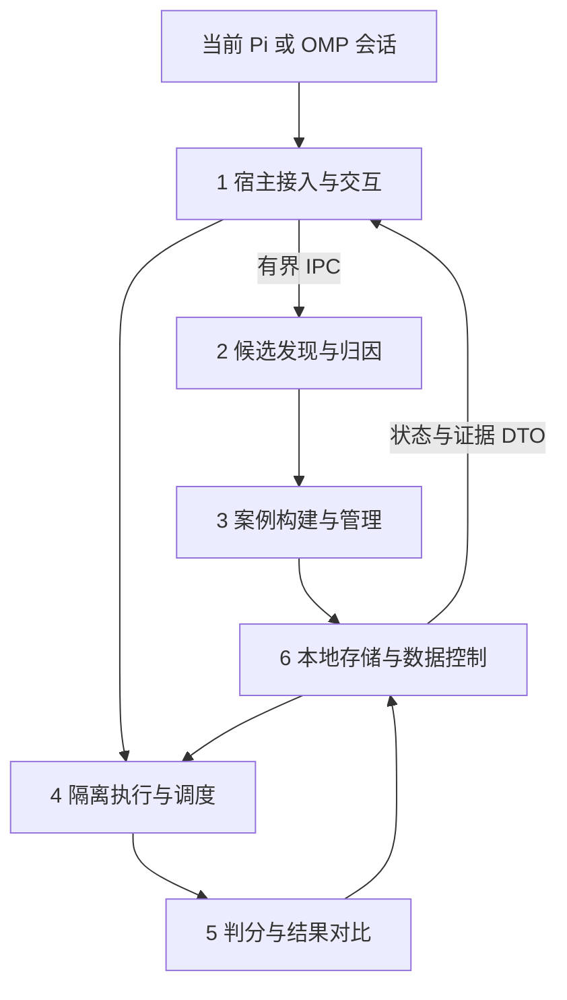

# CasePick 技术设计：Harness 内的失败记忆与回归验证

- 状态：实现前设计，不代表相关能力已实现或完成兼容验证。
- 依据：[产品需求](./casepick-plan.md)及后续范围决策。
- 首个宿主：Pi；实际使用环境：本地 oh-my-pi（下文称 OMP）。
- 目标：在同一 Harness 内完成真实失败发现、可信案例构建、隔离验证和证据反馈。

## 1. 决策摘要与范围

### 1.1 产品与工程定位

CasePick 是 Harness 插件，不是独立评测平台。评测是验证运行时行为的手段，技术重点是事件接入、上下文边界、工具权限、异步生命周期和可复现执行。

正常使用不等待提取和评测；证据充分时自动纳入，存在歧义时集中确认。用户可在原界面选择模型或配置重新执行，看到结论、证据、覆盖限制与实际消耗。

### 1.2 首期支持范围

| 范围 | 实现决策 |
| --- | --- |
| 输出约束案例 | 在无工具的新会话中执行，检查结构、字段和值等明确要求 |
| 工具行为案例 | 使用固定文件夹具和受限只读工具，验证工具选择、参数、先后关系及最终回答 |
| 采集 | 自动信号发现与显式标记并存；不对每条消息调用模型 |
| 案例维护 | 候选、确认、编辑、移除、精确去重、批量确认、版本记录 |
| 验证 | 快速检查与支持范围内的真实重放；原界面发起、取消、展示结果 |
| 数据与费用 | 本地存储、用途级外发授权、调用预算、暂停、删除、基础 JSONL 导出 |
| 对比 | 同一案例修正前后的可比结果；保留重复次数与各次结论 |

首期不支持任意 shell、任意项目环境恢复、生产系统写操作、浏览器登录态重放。需要这些能力的案例可以作为候选保存，但必须标记不支持重放，不能冒充可评测案例。

首期不建设独立 Web 前端、常驻后台服务、账号系统、分布式调度、排行榜、实验矩阵或自动修复系统。DSH 和独立评测平台联动后置。OMP 是实际兼容目标，但只有完成相同闭环验收后才能声明支持。

### 1.3 不可破坏的约束

1. 被测输入不得包含失败后才出现的纠正、答案或新增要求。
2. 已有回答只是证据，不自动等于标准答案；用户沉默不等于确认正确。
3. 新会话只隔离上下文，不隔离操作系统权限。
4. 外发授权与用户当前使用远端模型是两件事；无授权时不得新增提取或评分请求。
5. 环境失败、预算跳过、取消和无法判定，不记作模型失败。
6. 能加载扩展不等于宿主行为兼容；OMP 中启动原版 Pi 不能算 OMP 重放。
7. 采集缺失、脱敏损失和重放限制必须显式呈现。

## 2. 技术栈与部署形态

| 层次 | 选型 | 原因与约束 |
| --- | --- | --- |
| 语言 | TypeScript，strict 模式 | 插件、核心、执行与数据契约统一；不引入第二语言服务 |
| Pi 接入 | 官方 Extension API 与 SDK | 使用公开事件、命令、UI、会话及资源配置接口，不导入内部实现路径 |
| OMP 接入 | 官方扩展接口及宿主 SDK | 复用核心；对实际不兼容的事件、UI、执行能力做局部适配 |
| 本地核心进程 | Node.js 24 LTS 子进程 | 隔离数据库和重处理，避免阻塞宿主；是插件依赖，不是常驻服务 |
| 执行进程 | 与目标 Harness 匹配的运行时、SDK 版本 | Pi 使用锁定 Node/SDK 组合；OMP 使用经验证的 Bun/SDK 组合 |
| 存储 | SQLite + better-sqlite3，WAL | 同步数据库调用仅发生在核心子进程；多宿主实例通过事务协调 |
| 数据契约 | TypeBox + Ajv | 统一内部 JSON Schema；宿主工具 schema 在适配层转换 |
| 本地 IPC | stdio NDJSON | 跨 Node/Bun，易调试；不开放 HTTP 端口，不新增鉴权服务 |
| UI | 宿主原生命令、通知、状态栏与列表 | 无独立 React 应用；高级 TUI 只在必要时采用宿主组件 |
| 测试与构建 | Vitest、tsc、pnpm、锁文件 | 单 npm 包起步；没有真实需要不引入 monorepo 编排 |

本地核心进程管理数据库与任务；执行进程运行宿主 SDK。分开两者是为了避免将原版 Pi SDK 带入 OMP 重放，以及避免原生数据库依赖受 Node/Bun ABI 差异影响。

每个交互宿主按需启动自己的核心进程；同一用户的数据目录可以共享。SQLite 中的任务租约与预算事务用于防止重复领取和超额派发。不运行用户级 daemon，不要求退出 Harness 后继续工作。

首期每个核心进程至多运行一个评测项；跨实例仍执行共享预算检查。核心进程与执行进程启动失败时显示不可用原因，不退回在宿主主线程执行慢任务。

## 3. 模块边界与代码组织



```text
src/
  extension.ts             # Pi 入口，仅装配
  host/
    pi/                    # Pi 事件、UI、配置与会话驱动
    omp/                   # 经验证后增加的 OMP 差异实现
  discovery/               # 信号、归因、证据引用
  cases/                   # 输入构建、校验、去重、版本
  execution/               # 任务、预算派发、取消、Runner、受限工具
  grading/                 # 规则、模型判分、可比性
  storage/                 # SQLite、迁移、附件、授权、导出与删除
  contracts/               # JSON Schema、DTO、错误与状态定义
  process/                 # 核心/Runner 启动、IPC、退出清理
```

核心模块不导入 Pi/OMP 的 UI 或 SDK。模块之间传递普通数据，不传宿主上下文、数据库连接或密钥。`host/` 不实现归因、判分或去重算法。`contracts/` 是共享契约，不是新的业务服务。

不预先建设通用 Harness 插件框架；只抽取 CasePick 实际需要的读取事件、展示结果、创建执行会话、取消与计量边界。

## 4. 公共数据契约

以下字段是 CasePick 自有契约设计，不是声称宿主已经提供同名 API。实现时由 TypeBox 定义运行时 schema，并从同一份 schema 推导 TypeScript 类型。

### 4.1 统一事件与证据引用

`CapturedEvent` 至少包含：

- `schemaVersion`、`hostKind`、`hostVersion`、`workspaceId`。
- `sessionId`、`branchId`、`eventId`、`parentEventId`、`sequence`。
- `kind`：用户消息、助手完成消息、工具调用、工具结果、有效配置、分支变化或完整性异常。
- `payload`：经采集策略过滤的结构化数据。
- `toolCallId`：配对调用与结果；不以完成时间推断调用顺序。
- `origin`：人类输入、宿主注入、CasePick 评测等；不能识别时标记 unknown。
- `completeness`：complete、truncated、gap 或 unsupported。

去重键采用宿主、会话和稳定事件 ID；宿主没有稳定 ID 时，适配层使用明确记录的派生规则，不假定时间戳唯一。会话切换不能复用旧上下文对象。

`EvidenceRef` 引用源事件和字段位置，包含内容摘要。用于 UI 跳转和检验模型提取结果；模型返回的未知 ID、越界位置或不存在的原文引用必须拒绝。

### 4.2 案例版本

`CaseVersion` 分离以下区域：

| 区域 | 内容 | 是否传入被测模型 |
| --- | --- | --- |
| input | 截止点、必要历史、当时有效指令、待测用户输入 | 是 |
| environment | 固定文件清单、摘要、受限工具版本、前置条件 | 按实际执行需要 |
| expectation | 期望行为、当时要求的引用 | 只传原本已知的要求，不额外注入评分说明 |
| rubric | 规则版本、参数、评审协议 | 否 |
| provenance | 失败证据、后续纠正、纳入依据 | 否 |
| controls | 已知错误样本、经确认正确样本、确认来源 | 否 |

同时记录 `caseId`、`versionId`、`contentHash`、`parentVersionId`、`eligibility`、`replayModeSupport`。`cutoffEventId` 使用明确的排他边界：该事件及之后的内容均不得进入 input。

### 4.3 状态分层

- 候选状态：`pending_analysis`、`needs_confirmation`、`accepted`、`dismissed`。
- 案例状态：`active`、`removed`；版本资格为 `eligible` 或 `ineligible`，附原因。
- 任务状态：`queued`、`running`、`cancel_requested`、`completed`、`cancelled`、`interrupted`、`failed`。
- 执行项状态：`pending`、`running`、`completed`、`cancelled`、`budget_skipped`、`environment_error`、`unreplayable`、`interrupted`。
- 行为结论：`pass`、`fail`、`indeterminate`，仅对具有足够执行证据的结果赋值。

完成执行不代表通过；任务系统失败也不等于行为失败。部分完成运行的摘要从执行项推导，并显示所有未完成原因。

## 5. 模块一：宿主接入与原生交互

### 5.1 职责与入口

Pi 入口默认导出扩展注册函数，使用 `pi.on()`、`pi.registerCommand()` 和 `ctx.ui`。启动时只注册能力，不在工厂中启动长期后台资源。后台进程在会话启动或首次命令需要时启动。

会话、消息与工具事件的精确字段以锁定 SDK 的导出类型为准。优先采集完成态消息与工具结果，避免逐 token 传输；有效系统指令、模型参数和工具清单在被测边界捕获。只读观察，不修改正常对话或工具返回值。

使用以下自有操作边界：

| 操作 | 行为 |
| --- | --- |
| `observe` | 将宿主事件转成统一 DTO，不运行提取模型 |
| `snapshotEffectiveConfig` | 捕获有效模型、指令、工具、扩展/技能与宿主版本；不可取得的字段标记缺失 |
| `showCasepickView` | 根据 DTO 展示候选、结果、状态与证据 |
| `launchReplay` | 启动目标宿主的 Runner，不继承当前会话 |
| `cancelReplay` | 请求取消并等待明确的终止状态 |

### 5.2 低侵入采集与背压

事件回调仅做轻量投影、限制大小、执行基础敏感字段过滤并放入内存有界队列，立即返回。不得同步读写 SQLite、压缩完整历史或等待模型。

初始队列上限建议 256 个事件、合计 8 MiB；单事件正文上限 128 KiB。它们是可调整的安全边界，不是已测性能承诺。巨大工具输出只保存允许的片段和缺失标记；不能把截断数据当完整证据。

核心进程持久化后发送确认。达到队列上限时停止接收超限正文，记录会话 gap 和丢弃计数，并显示“采集不完整”。重启后可在授权范围内从宿主持久历史补齐；补齐不了就保留缺失，禁止相关候选自动纳入。

### 5.3 用户交互

统一使用 `/casepick`，子命令包括 `mark`、`candidates`、`run`、`results`、`pause`、`resume`、`export`、`delete`。

- 首次启用：展示采集范围、存储位置、外发默认关闭及预算设置。
- `mark`：选择当前失败片段，立即给出已记录或未持久化状态，归因后台进行。
- `candidates`：按原因批量确认；歧义要求必须显式修正，不提供绕过资格检查的“一键全部通过”。
- `run`：展示案例范围、模式、模型/配置变化、重复次数、预计费用及不支持项，再执行。
- `results`：展示结论、证据、执行范围、逐次结果、耗时和用量。
- 状态栏：采集开关、待确认数、任务进度、异常和预算状态；不逐条弹窗。

结果默认作为 UI 数据展示，不自动写入当前模型上下文；用户明确要求分享结果时才发送消息。

### 5.4 生命周期与 OMP 兼容

以宿主会话实例和分支标识隔离状态，不在模块全局保存“当前案例”。卸载、重载、退出和切换流程使用幂等清理：停止新采集、取消本实例任务、释放监听、终止所属子进程。核心子进程检测父 IPC 断开后退出；异常终止由下一次启动识别过期任务。

OMP 官方兼容加载只证明存在兼容路径。分别验证事件字段、完成边界、工具 schema、UI、SDK 会话创建、计量和取消。工具 schema 从 CasePick 自有契约转换，不依赖 TypeBox 兼容 shim 具有全部 Ajv 语义。

OMP Runner 必须报告真实 `hostKind=omp`、版本和有效配置。无法建立 OMP 原生 Runner 时，关闭 OMP 执行入口并说明原因；可单独展示“使用 Pi 验证”，但不得标为 OMP 结果。

### 5.5 验收

在真实 Pi 和目标 OMP 版本中分别验证：命令可用、采集正确、提取期间正常对话不等待、会话切换不串数据、重载无重复监听、退出无遗留子进程。记录回调耗时与队列峰值，而不是只验证扩展可被导入。

## 6. 模块二：候选发现与归因

### 6.1 两段式处理

第一段为本地信号筛选：明确纠正语句、约束违背线索、工具失败、已有验证结果及用户显式标记。同一会话分支、同一失败行为和同一要求的连续信号聚合成一个候选，不为每条消息创建模型请求。

第二段分析候选窗口：先采用可验证规则；复杂语义在获得 `extract` 用途授权和预算后调用提取模型。默认关闭外发时，保留候选并允许人工填写，不偷偷借用当前会话模型。

只选取失败之前的相关要求、失败轨迹及用于归因的后续纠正，明确分区。初始自动窗口限制为最近 12 个完成回合且受字节上限约束；超出窗口不能证明要求不存在，只能标记需要扩展证据。允许从同分支更早的事件中按引用补取，不默认复制完整会话。

### 6.2 归因结果

模型或规则输出必须通过 schema 和证据引用验证：

- `classification`：已有要求违背、需求补充、目标变化、环境故障、混合原因或证据不足。
- `requirementRefs`：当时已知要求的引用。
- `failureRefs`：被认为违背要求的行为引用。
- `correctionRefs`：之后的纠正，仅供归因。
- `proposedCutoff`：被测行为开始前的边界。
- `missingEvidence`、`rationale`：缺失项及简短理由。

混合原因不强行二选一；例如路径错误可能由模型参数和文件缺失共同导致，需保留两类证据。模型置信度不作为纳入门槛。

### 6.3 降级与验收

模型不可用、授权缺失、预算不足或结构化结果不合法时，候选转待确认，保存原因。不会阻塞会话，也不会把失败的提取结果当可评测案例。

使用带人工标注的真实样本分别覆盖纠正、新增要求、目标变化、环境故障和混合原因；按类别报告混淆情况，不能只报告整体准确率。对每个自动归因结果验证引用真实存在且时间边界成立。

## 7. 模块三：案例构建与管理

### 7.1 构建算法

1. 固定候选来源分支和被测截止点，禁止混合其他分支的替代历史。
2. 找出当时有效的用户要求和系统/开发者指令；保留优先级与变化信息。
3. 选择完成任务所必需的历史消息、工具调用与对应结果，保持调用/结果配对。
4. 将后续纠正、原错误输出和参考正确行为放入 provenance/controls，不进入 input。
5. 收集最小环境夹具、工具定义和摘要，明确与原环境的差异。
6. 构建规则并运行正反例检查，进行敏感信息和完整性检查。
7. 计算去重指纹，满足门槛后创建正式案例版本，否则回到待确认。

上下文压缩优先采用原文选择，不用模型摘要替代关键要求。必须使用摘要时记录转换过程，并要求确认语义未变。对于宿主历史已压缩、有效指令无法恢复的案例，不宣称精确重放。

### 7.2 自动纳入门槛

以下条件必须全部满足：

- 当时已存在的要求可被明确引用。
- 失败证据完整且能够对应到要求。
- 评分规则能检查目标行为，而不是模型自评。
- 已知错误控制样本被判失败。
- 经用户确认或独立确定性依据验证的正确控制样本被判通过。
- 脱敏未破坏语义；依赖环境在所选执行模式下可恢复。

没有正确控制样本时保留候选。模型生成的“正确答案”可以是待确认材料，不能因为另一个模型赞同就视为独立验证。人工确认也不能绕过答案泄漏、缺失环境等硬性限制。

### 7.3 去重与版本

精确指纹覆盖规范化 input、期望行为、规则与环境清单，使用 SHA-256。只规范化 JSON 键序等无语义差异，不随意删除代码空白、排序消息或改写自然语言。

相同指纹合并来源引用；相似要求和文本只提出重复建议，不自动合并。不同工具版本、期望行为或环境条件保留不同案例/版本。首期不使用向量数据库。

修改输入、规则、夹具或期望行为创建不可变新版本；历史结果仍引用原版本。移除表示退出默认运行集合，删除则真正清理内容，二者在界面中分开。

### 7.4 默认案例选择

按归因类别、规则类型、工具类型分组，先去重，再按未验证、最近失败等确定性规则选取小规模代表集。默认最多 10 例，用户可选择全部支持的案例。

选择算法与版本、选中 ID、排除原因写入运行清单。同一次对比固定相同案例版本，不在两边独立抽样；明确这是个人失败回归集合，不是全面能力评测。

### 7.5 验收

覆盖后续答案泄漏、分支污染、已压缩历史、工具结果错配、要求变化、脱敏损失、精确重复与相似但不同要求。正反例检查不能只断言“有评分结果”，必须断言错误失败、确认正确通过。

## 8. 模块四：隔离执行与调度

### 8.1 三种模式的语义

| 模式 | 执行内容 | 能支持的结论 |
| --- | --- | --- |
| `trace_check` | 对录制轨迹重新判分，不调用被测模型 | 旧行为是否满足当前规则；不代表新模型修复 |
| `quick_check` | 新会话使用裁剪输入；无工具或明确标注的录制工具反馈 | 有限条件下的新行为表现，不覆盖真实工具环境 |
| `fixture_replay` | 新会话实际调用版本固定的受限工具，读取固定夹具 | 支持范围内的端到端行为；不代表任意原始工程环境 |

录制工具反馈仅在工具名和规范化参数与录制内容匹配时返回；参数偏离则标记覆盖不足，不把旧结果硬塞给新调用。

“全部案例运行”与“完整重放”是两个概念。首期完整重放仅指被声明支持的夹具任务，不使用营销式“任意任务重放”表述。

### 8.2 运行清单与预检

运行前冻结 `RunManifest`：案例/规则版本、模式、目标宿主版本、模型标识、有效配置、环境摘要、工具版本、重复次数、选择算法、预算和授权策略版本。

对每项检查：资格、所需能力、夹具摘要、有效指令、模型可用性、外发授权、预算计量能力。失败项直接记录不可重放/环境错误，不启动推理。

首期只允许选取明确模型和保存的配置快照/差异，不允许传入任意可执行 JS 作为“配置”。被比较变化之外的设置保持一致。

### 8.3 会话与资源隔离

执行进程使用目标宿主的 SDK，创建全新会话与独立临时目录，显式配置：

- 案例 input 中的当时有效指令和最小历史。
- 固定模型参数、输出上限及最大步骤数。
- 明确工具列表和资源加载器。
- 禁止自动发现当前项目扩展、技能、提示模板、MCP 和其他工具。
- 禁用 CasePick 采集，不递归生成案例。
- 不继续当前会话，不导入原会话的失败后内容。

Pi `createAgentSession()` 默认资源发现不可直接用于本设计。OMP 的关闭扩展选项也不能被当成关闭所有资源发现或实现沙箱。

SDK 在执行前若仍注入了无法控制的隐式指令/资源，预检应拒绝“精确重放”声明，记录实际配置差异；必要时只支持明确标注的受限验证模式。

### 8.4 工具权限边界

首期不向模型暴露 shell、网络、写文件、插件安装或宿主工具转发。只注册 CasePick 自有的固定夹具读取工具。

优先在执行前将允许文件载入只读内存映射，由模型以逻辑相对路径访问。读取过程中拒绝绝对路径、`..`、非普通文件和符号链接；打开后检查文件属性和摘要，复制到受控快照后再提供，避免路径检查与读取之间的替换问题。限制单文件大小、总字节数、调用次数和返回长度。

不存在文件属于明确的工具返回；若规则要求先读该文件而模型绕过，可构成行为失败。夹具缺失或摘要不符则是环境失败，二者不可混用。

本设计保护模型可调用的能力边界，不宣称抵御恶意 npm 插件、被攻陷 SDK 或同账户恶意进程。执行进程只加载信任且固定版本的代码。以后开放 shell 时必须先引入 OS/容器隔离、默认拒绝网络和凭据挂载，不能只加命令字符串黑名单。

### 8.5 调度、持久化与重复执行

`jobs` 记录所有者实例、租约到期时间、心跳和任务状态。领取工作使用 SQLite 短事务；同一任务只能有一个有效所有者。超过租约的运行标记 interrupted，而不是直接声称成功或自动重新付费执行。

每个重复项创建新的会话和临时资源，不共享上一轮对话。固定随机种子仅在模型支持时记录，不承诺远端推理可完全确定。

首期默认不自动重试可能已提交的付费请求。断线或子进程退出后请求是否执行不明时，记录 outcome unknown；用户明确重跑产生新的 attempt，旧消耗不抹去。

### 8.6 预算和取消

所有提取、被测推理和模型判分必须经过统一调用边界，按用途写入账本：

1. 校验用途、提供方、目的地址、授权范围及有效期。
2. 估计本次输入与最大输出、其他可计费项的上界。
3. SQLite 事务检查“已结算 + 已预留 + 本次预留”不超过对应上限，原子预留。
4. 持久化 dispatch 状态后发起调用；每次续步也要重新预留。
5. 用实际 usage 结算，保留提供方原始计量及价格版本。

只有在 SDK/provider 边界可以覆盖所有请求（包括内部重试）的情况下，才声明硬调用额度控制。不能拦截内部续步/重试时，禁用该路径或关闭相应自动行为；不能仅对外层 prompt 调用计一次预算。

取消先原子写入 cancel_requested，停止派发，再传播 AbortSignal 到模型和工具；给予短暂清理期限，超时结束所属执行进程。已发生的费用仍结算。取消与完成竞争时保留已经取得的结果，不把完成项改为失败；新任务不得越过已观察到的取消状态派发。

价格或用量不确定时显示 unknown，未结算请求保留预留，不按零处理。金额以整数微货币单位计量；不同币种不直接相加。对于无法可靠给出单次费用上界的模型，只能提供 token/调用数限制及费用估算，不承诺绝对金额封顶。

### 8.7 验收

真实运行支持的两类案例，证明新输出和工具轨迹确实产生。验证夹具越界、符号链接、配置污染、取消竞态、并发额度预留、子进程退出和运行中宿主关闭。没有模型凭据时可以验证调度与本地规则，但不能据此宣布真实模型闭环已通过。

## 9. 模块五：判分与结果对比

### 9.1 确定性规则

首期使用版本固定的有限规则集合，不接受从案例导入任意脚本执行：

- `json_schema`：输出必须可解析并满足指定 schema。
- `value_equals` / `value_absent`：指定 JSON Pointer 位置的明确值约束。
- `literal_required` / `literal_forbidden`：仅用于要求明确的原文字面约束，不猜测自然语言同义词。
- `tool_required` / `tool_forbidden`：工具名与必要参数约束。
- `tool_precedence`：定义必要先后关系，而不是要求逐字复制整条轨迹。

JSON 解析失败与 schema 失败分别给出位置和原因。工具并发时不能凭结果到达顺序判先后；只使用实际调用事件及明确依赖。缺乏足够时序证据时判 indeterminate。

不内置任意用户正则或 shell 评分命令，避免 ReDoS 和代码执行边界扩张。后续有真实需求再加入受限实现。

### 9.2 模型评分

仅在规则不能覆盖且得到 `judge` 授权时启用。固定 rubric、提示模板、模型/版本与参数；输入中把被评分文本明确当作不可信材料，不让其改写评分指令或访问工具。

输出结构包含 verdict、每条准则的结果、证据引用及无法判定原因。无证据或相互冲突时判 indeterminate。没有真实模型版本标识时记录提供方返回的可见标识，不编造版本。

生成案例与判分不共享隐藏对话状态；不同模型并不天然独立可靠。模型评分规则仍必须用经确认正反例校准，人工接受优先于模型自报置信度。

### 9.3 合并与对比

必需规则中存在有充分证据的 fail，则总判 fail；没有 fail 但存在无法判定，则总判 indeterminate；全部必需规则通过才判 pass。执行未正常完成或证据完整性不满足时，不用缺失轨迹直接判行为失败。

比较前建立 `comparisonKey`：案例版本、规则版本、环境摘要、模式、宿主与工具配置、除显式比较变量之外的模型配置。不能简单删除整个 config 再比较；只排除用户明确选择的变化字段。

非目标因素不一致时并排展示但标记不可严格比较。Pi 与 OMP 的比较属于更换整个宿主条件，不归因为纯模型提升。

每次重复结果保留，展示 pass/fail/indeterminate 次数与未完成项。只有可比的已判定结果参与“修复/新增失败”分类；重复结果混合时标记不稳定，不宣传稳定修复。若展示通过率，必须同时给出分母与无法判定数。

### 9.4 验收

覆盖 JSON 边界、错误证据、并发工具时序、评分提示注入、规则版本变化、环境变化和混合重复结果。断言实际 verdict、证据定位和可比性原因，不编写“返回对象非空”类测试。

## 10. 模块六：本地存储与数据控制

### 10.1 数据目录与 SQL 策略

默认采用用户数据目录 `$XDG_DATA_HOME/casepick`，未设置时使用 `~/.local/share/casepick`；可显式配置。目录权限 0700、数据库与附件 0600，在支持这些权限的平台实施。宿主本身的会话存储不迁入该目录。

启用 foreign_keys、WAL 和短事务；设置有限 busy timeout，遇到繁忙保留任务并反馈，不在宿主回调等待。迁移用递增 schema version 和事务执行；新版本数据库遇到旧客户端时拒绝写入，不做隐式降级。

不采用 ORM：用参数化 SQL、明确查询函数和迁移文件。SQL 值均绑定参数，排序与字段选择从白名单产生。

### 10.2 数据表

| 表 | 关键字段与约束 |
| --- | --- |
| `source_events` | 宿主/会话/事件复合唯一键、分支、sequence、内容引用、完整性、过期时间 |
| `candidates` | 来源范围、归因结果、待确认原因、状态；引用来源证据 |
| `cases` | 稳定 case_id、当前版本、active/removed |
| `case_versions` | 不可变输入、期望、纳入依据、cutoff、content_hash、规则/环境引用 |
| `rubric_versions` | 规则及模型评审配置、正反例校验记录 |
| `environment_manifests` | 夹具清单、文件摘要、工具版本、恢复与支持条件 |
| `artifacts` | 相对路径、摘要、大小、敏感等级、引用关系 |
| `runs` | 固定运行清单、宿主/模型、比较变量、开始结束时间 |
| `run_items` | 案例版本、重复索引、执行状态、行为结论、证据、耗时 |
| `jobs` | 状态、所有者、租约、取消标记、关联运行项 |
| `usage_ledger` | request_id 唯一、用途、币种、预留、dispatch、实际计量、unknown 状态 |
| `consents` | 用途、目的地址/提供方、数据范围、授权版本、撤销时间 |

列表查询按更新时间和稳定 ID 游标分页，避免加载全部轨迹。结构化字段可使用 JSON 文本，但列表过滤字段单独建列和必要索引。

### 10.3 附件与保留策略

大工具输出和夹具存储为内容寻址附件。写入先临时文件，再原子改名，数据库记录引用；崩溃造成的无引用附件由启动维护流程回收。不能把用户传入路径直接当附件存储路径。

未被案例引用的采集片段默认保留 7 天；空间达到配置上限时，先清理过期且无引用数据，仍不足则暂停采集并提示。不会为了腾空间静默删除正式案例证据。

哈希用于完整性和去重，不等于匿名化。共享附件删除时检查所有引用，不能破坏其他案例。

### 10.4 隐私、授权与删除

首次授权区分 capture、extract、replay、judge；远端调用按用途、目的地址和数据范围授权，撤销后未派发请求立即失效。在途请求尽力取消，但不声称可以追回已发送数据。

采集前排除凭据字段和明显密钥；进程内过滤后再 IPC，入库和外发前追加校验。敏感检测不可能保证发现所有秘密，因此允许用户排除路径/会话、预览外发内容。脱敏使要求、路径或规则失真时，案例转待确认。

日志只记录 ID、阶段、错误码、耗时和用量，不记录原始提示、工具输出或凭据。敏感调用凭据仅经受控内存/IPC 传递，不出现在命令行参数、数据库、RunManifest 或普通日志。

删除流程：停止关联任务并设置持久删除标记，禁止迟到结果重新写回正文；事务删除业务内容和引用；清理无引用附件；按数据库维护策略清理空闲页/WAL。请求账本可以保留无内容的最小费用记录，并明确说明。

SQLite 不默认加密。物理介质、系统备份和已经导出的文件不保证可擦除；宿主原会话不由 CasePick 自动删除。界面应区分这些边界，不承诺“全机器彻底删除”。

### 10.5 JSONL 导出

每行包含 `schema_version`、`record_type`、稳定 ID 和 payload；记录类型包括 case_version、rubric_version、environment_manifest 及可选 run_result/artifact。为保持单文件可迁移性，小型必要附件使用带编码声明的内联内容，并记录大小与摘要。

导出前执行相同敏感策略和引用完整性检查。默认不导出完整原始会话、凭据与本机绝对路径；如果移除必要字段会破坏可执行性，应标记 `replayable=false` 及原因，不静默输出貌似完整的案例。

首期不实现远端同步、自动上传和平台 API。稳定 ID、版本与 JSONL 足以作为未来联动边界。

### 10.6 验收

使用临时目录和真实 SQLite 验证事务、版本引用、重复事件、跨连接预算竞争、租约过期、附件回收、删除与迟到结果竞态、脱敏导出及格式完整性。不能把 JSONL 文件存在当成导出成功，需逐行解析并验证引用闭合。

## 11. IPC、错误处理与资源上限

IPC 消息统一包含 `protocolVersion`、`requestId`、`instanceId`、`type`、`payload`；响应回传 requestId。版本不兼容拒绝启动，不猜测字段。stdout 只传协议，stderr 仅传脱敏日志。

核心进程支持捕获批次、候选处理、运行创建、取消、查询、导出和删除等明确命令。所有消息用 schema 校验，限制消息大小、队列容量与等待时间；执行进程不能通过 IPC 请求任意文件读取或任意命令执行。

统一错误类别：authorization_required、budget_exhausted、capture_incomplete、host_unsupported、environment_unavailable、provider_error、grading_indeterminate、storage_error、cancelled。错误携带可展示原因与证据 ID，不泄漏原始请求。

不会为了“让流程成功”把模型错误吞掉、把不可重放改成通过或自动切换模型。宿主功能缺失时显示明确限制；数据读取失败时停止相关派发，正常用户对话保持可用。

## 12. 测试、真实验收与效果指标

### 12.1 分层验证

| 层次 | 工具/环境 | 必须覆盖 |
| --- | --- | --- |
| 纯逻辑 | Vitest | 时间边界、分支、去重、规则、比较、状态转换 |
| 存储与进程 | 临时 SQLite、真实子进程 | 持久化确认、竞态、取消、崩溃、删除与导出 |
| 宿主集成 | 锁定 Pi 与 OMP 版本 | 加载、事件语义、UI、模型请求拦截、资源关闭 |
| 真实闭环 | 用户授权模型、真实失败样本 | 从纠正到新执行，再到结果、证据与消耗 |

使用测试替身可以验证调度边界，但不能把模拟模型回包当真实重放证明。没有测试专用付费凭据时，常规 CI 跑确定性测试；真实模型验收单独授权执行并保存脱敏证据。

### 12.2 必须通过的端到端场景

1. 用户先要求严格 JSON，模型输出违规；后续纠正被识别，构建案例且未泄漏纠正；确认正反例后纳入。
2. 用户后来新增格式要求，候选正确归类为需求补充，不自动标记旧回答失败。
3. 文件夹具任务要求先读取再回答，真实调用受限工具，评分给出调用与结果引用。
4. 夹具不可恢复时显示不可重放，不计模型失败；越界工具请求被拒绝且留证。
5. 调整模型或明确配置后重复执行同一版本，展示全部成功/失败/无法判定次数。
6. 预算不足停止新派发；取消留下部分结果；提供方计量缺失显示未知费用。
7. 暂停后不再采集，删除后关联内容不被迟到任务恢复，导出不含被排除的敏感内容。
8. OMP 通过以上相同场景，并证明执行宿主确为 OMP，而不是原版 Pi。

### 12.3 试点指标口径

| 指标 | 口径 |
| --- | --- |
| 人工维护时间 | 用户主动计时或确认的维护时长；不以点击数推断 |
| 案例直接可用比例 | 试点审查样本中无需修改即可用于验证的案例数 / 已审查案例数；注明抽样方法 |
| 环境可重放比例 | 目标支持范围内预检通过数 / 尝试预检数；另报范围外数量 |
| 原错误复现 | 原模型与原配置在可恢复条件下的失败次数 / 有效尝试次数，附不确定项 |
| 单次耗时与成本 | 从运行创建到终止的墙钟时间、模型 usage、结算费用及 unknown 数量 |
| 确认回归 | 可比运行中由通过变失败并经复核确认的条目，不把一次不稳定波动直接计入 |

在试点前固定分母、抽样与统计周期；目标值由基线决定。性能目标先测量再设阈值，不在设计中虚构低延迟或高准确率。

## 13. 实现顺序与完成门槛

### 阶段 A：宿主接入验证

先以人工提供的一个真实失败案例打通 Pi：命令入口、事件与有效配置读取、新会话真实执行、受限工具、取消、原界面结果。验证每次付费请求是否可拦截计量。

同时在 OMP 验证加载与关键 API 差异，建立兼容表。阶段 A 是技术风险验证，不是最终产品交付；不能停在只采集或只加载成功。

### 阶段 B：可信案例与本地维护

落地 schema、SQLite 迁移、证据引用、时间边界、候选归因、正反例门槛、去重、编辑与版本、批量确认、授权和数据控制。

完成门槛：真实纠正、新增要求、目标变化、环境故障样本均有可追溯处理路径；没有授权仍能使用本地和人工路径。

### 阶段 C：完整插件闭环

接入异步提取、运行清单、预算、代表集、重复运行、规则/模型判分、对比、暂停、删除和 JSONL 导出。

完成门槛：第 12 节 Pi 真实闭环全部通过，具有实际耗时、消耗和限制说明；支持范围之外的任务明确拒绝。

### 阶段 D：OMP 使用验收

仅对实际差异补适配，使用 OMP 自身执行路径完成相同闭环。未通过的能力在兼容表中明确禁用；通过后发布兼容宿主/版本范围。

DSH、任意 shell 容器重放、成功任务代表性增强以及评测平台联动不纳入以上阶段，不以未来计划替代当前闭环。

## 14. 已知依据、待验证事项与风险

### 14.1 已核实的文档事实

- Pi 官方扩展接口提供事件、命令与 UI，扩展具有宿主进程的 OS 权限。
- Pi SDK 提供新建会话及资源/工具配置，但默认会发现工作目录资源和已有设置。
- OMP 官方文档提供 Pi 扩展导入兼容和 `pi.extensions` 识别；原生扫描目录使用 `.omp`，不应假定扫描 `.pi/extensions`。
- 当前工作环境曾执行版本命令，输出 `omp/18.8.6`；这不证明其实现与官方 main 文档完全一致。

### 14.2 开工时必须验证

| 风险 | 验证动作 | 不满足时的决策 |
| --- | --- | --- |
| Pi/OMP API 漂移 | 对锁定版本运行事件、UI、会话与清理 smoke | 限定支持版本；不导入内部路径硬凑兼容 |
| 计费路径绕过预算 | 检查实际每次模型请求、续步、内部重试 | 禁用不可拦截路径，不能宣称严格预算支持 |
| 配置快照不完整 | 比对真实请求的有效指令、工具和模型参数 | 标注受限模式或不可重放，不宣称精确恢复 |
| SDK 自动加载资源 | 在带污染项目配置的环境启动测试会话 | 使用显式加载器；无法关闭则阻止相关模式 |
| OMP 下原生依赖不兼容 | 实际启动 Node 核心进程与 OMP Runner | 保持数据库在固定 Node 运行时，不静默更换存储 |
| 插件关闭与计费请求竞态 | 运行中取消、关闭宿主、模拟断线 | 保留 interrupted/unknown 及预留，不自动重复付费 |
| 附件或上下文脱敏失真 | 对脱敏前后规则和必要实体进行审查 | 转候选确认或拒绝自动纳入 |

### 14.3 官方参考

- [Pi Extensions](https://github.com/badlogic/pi-mono/blob/main/packages/coding-agent/docs/extensions.md)
- [Pi SDK](https://github.com/badlogic/pi-mono/blob/main/packages/coding-agent/docs/sdk.md)
- [OMP Extensions](https://github.com/can1357/oh-my-pi/blob/main/docs/extensions.md)
- [OMP Extension Loading](https://github.com/can1357/oh-my-pi/blob/main/docs/extension-loading.md)

这些链接指向可变分支，用于说明设计依据，不是依赖锁定记录。开始实现时固定实际包版本、锁文件及对应源码版本，并将通过的宿主版本与验证结果写入兼容记录。
