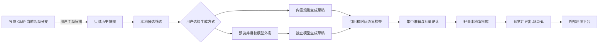

# CasePick 技术设计：Harness 内的失败案例生产与交付

- 版本：2026-10-10，生产者定位修订版；覆盖此前的 Harness 内评测设计。
- 状态：业务能力仍为实现前设计；已实现并验证 Pi 命令入口，范围见第 8.1 节，不代表扫描或双宿主兼容已完成。
- 首期宿主：Pi 与 oh-my-pi（OMP）同期支持、分别验收。
- 目标：用户主动扫描真实会话，生成并确认失败案例，在本地维护后导出给评测平台。
- 依据：本轮逐项确认的产品决策。[原 PRD](./casepick-plan.md)仍保留自动采集、原生评测等旧范围；冲突处以本版设计为准，原 PRD 不作为这些旧能力的实施要求。

## 1. 定位与范围

### 1.1 产品定位

CasePick 是 Harness 内的失败案例生产工具，不是评测执行器。Harness 负责整理输入、预期和证据，评测平台负责恢复环境、执行、评分和对比。

完整案例指被测输入、预期行为及来源依据齐备，不表示执行环境可恢复、评分规则已校准或原错误已复现。正式案例只能称为“用户确认的失败案例”，不能标成“已验证失败”。

### 1.2 已确认的产品决策

| 方面 | 首期决策 |
| --- | --- |
| 宿主 | Pi 与 OMP 同期支持，共享生产逻辑，分别验证历史读取与交互 |
| 触发 | 用户主动扫描当前会话的活动分支，不提前持续记录 |
| 生成方式 | 用户主动选择规则或模型，不自动升级为付费请求 |
| 内置规则 | 若干固定规则生成可编辑草稿，不确定内容由用户补全 |
| 模型生成 | CasePick 独立配置 OpenAI-compatible Chat Completions 模型 |
| 审核 | 在 Harness 内集中批量审阅、编辑和确认 |
| 案例资格 | 只收当时已有要求被违背的失败，不把新增要求追溯为旧失败 |
| 输入构建 | 选择必要原文，保留引用，不改写关键要求、不补造历史 |
| 预期 | 自然语言预期，加可选结构化约束；不在插件内判分 |
| 环境 | 描述已知依赖和缺失项，不要求恢复可执行环境 |
| 本地维护 | 轻量文件案例库，保存草稿、正式案例和不可变版本 |
| 交付 | 平台未定，首期导出版本化 JSONL 文件 |
| 证据 | 最小引用证据内联，原错误输出及后续纠正与 input 分区 |
| 数据审查 | 每批模型外发、每批文件导出都预览实际内容并确认 |

### 1.3 不在首期范围

- 不创建评测 Runner，不调用宿主 SDK 建立被测会话，不在当前对话中执行回归。
- 不实现工具沙箱、项目环境恢复、评分器、正反例运行、实验调度或修复对比。
- 不维护评测请求预算账本，不展示未经执行得到的 pass/fail。
- 不持续监听对话正文做采集，不自动发现并纳入案例，不退出后继续后台工作。
- 不实现平台上传、平台认证、结果回传、独立 Web UI、常驻服务或账号系统。
- 不默认复制整个会话、项目目录或文件附件，不把工具调用记录视为可执行工具实现。

### 1.4 不可破坏的约束

1. 被测输入只能来自被测行为开始前已知的内容；后续纠正、原错误回答不能混入输入。
2. 原要求必须有可验证来源；用户确认不能把新增要求变成旧要求，也不能绕过证据缺失。
3. 模型只提出草稿，不决定正式纳入，不凭置信度证明失败。
4. 当前会话模型配置、凭据和外发许可不自动授权案例生成。
5. 历史压缩、缺失、截断、来源不明和脱敏损失必须显式表示。
6. 导出完成只表示文件交付成功，不表示平台接收、可执行或评测通过。

## 2. 用户流程与职责边界



| 阶段 | CasePick 责任 | 评测平台责任 |
| --- | --- | --- |
| 发现 | 扫描已有历史，提出疑似失败片段 | 不直接读取本机工作会话 |
| 构建 | 选择输入原文、整理预期、引用证据、描述依赖 | 判断平台支持哪些任务和环境 |
| 确认 | 检查材料完整性，由用户确认已有要求被违背 | 校准评分协议和参考样本 |
| 交付 | 生成可独立核验来源片段的文件 | 按平台格式导入或转换 |
| 执行 | 不承担 | 环境、模型、工具、调度、取消、费用 |
| 结果 | 不生成评测结论 | 评分、重复运行、对比和报告 |

## 3. 技术栈与部署形态

| 层次 | 选型 | 边界 |
| --- | --- | --- |
| 语言 | TypeScript，strict 模式 | 单包起步，共享生产逻辑 |
| 宿主 | 各自公开 Extension API | 不导入内部实现路径，不依赖创建 Agent 会话 |
| 数据契约 | TypeBox + Ajv | 从同一 schema 推导类型；不同宿主边界仅传普通 DTO |
| 本地存储 | JSON 文件、异步文件 I/O | 不引入 SQLite、原生数据库驱动或数据库子进程 |
| 生成接口 | 独立 HTTP 客户端调用 Chat Completions | 不加载宿主模型会话或复用隐藏上下文 |
| UI | 宿主命令、选择器、编辑器、通知、状态栏 | 复杂批量审阅确有需要时使用宿主 TUI 组件 |
| 开发验证 | pnpm、锁文件、tsc、Vitest | Pi 的 Node 与 OMP 的 Bun 环境分别验证 |

默认运行在扩展进程内，使用异步 I/O 和受限批处理，不设 Core 子进程或 IPC 协议。扫描和校验必须限制单次工作量，在批次间让出事件循环；不能把同步解析整个巨大历史文件当作低侵入实现。

生成请求可异步进行，用户继续正常对话；插件退出、重载或会话切换时取消本作用域操作。首期一个扩展实例同时处理一个生成批次，批次内串行派发模型请求，不建设任务调度服务。

## 4. 模块与接口

```text
src/
  extension.ts               # Pi 注册入口
  omp-extension.ts           # OMP 注册入口
  host/
    pi/                      # Pi 历史读取、生命周期、UI
    omp/                     # OMP 对应适配
  scan/                      # 活动分支快照、候选定位、完整性
  generation/
    rules/                   # 固定规则与模板
    model-client.ts          # Chat Completions 调用
    build-draft.ts           # 草稿组装与引用解析
  cases/                     # 时间边界、资格、确认、版本与去重
  storage/                   # 文件库、原子写入、删除
  export/                    # 脱敏预览、JSONL 打包、引用闭合
  contracts/                 # schema、DTO、错误和状态
```

核心模块不导入宿主 UI 或 SDK。适配层只提供 CasePick 所需的窄接口，不预建通用 Harness 框架：

| 自有接口 | 行为 |
| --- | --- |
| `readActiveBranchSnapshot` | 在用户请求时取得固定会话、活动分支和读取边界内的历史 |
| `readAvailableConfig` | 返回可观察配置、来源和捕获时点；不把当前配置伪装成历史配置 |
| `showDraftReview` | 显示输入、预期、证据、缺失项和编辑确认操作 |
| `showDisclosurePreview` | 显示实际将发送或导出的内容与目的地 |
| `showOperationStatus` | 显示扫描、生成、保存、导出状态及取消入口 |

这些名称是 CasePick 自有边界，不代表 Pi/OMP 已提供同名 API。

## 5. 宿主接入与按需扫描

### 5.1 生命周期

扩展工厂仅注册命令与必要生命周期处理。启动后不读取、复制或监听普通会话正文；只有主动扫描才读取内容。会话生命周期通知只用于作用域失效和操作取消，不用于提前留存证据。

每次操作绑定 `operationId`、宿主、会话 ID、分支锚点和上下文代次。异步结束前校验作用域仍有效；旧会话结果不能覆盖新会话 UI。切换、重载和退出执行幂等取消，迟到响应不得恢复已取消或已删除的数据。

### 5.2 读取历史的规则

1. 固定当前活动分支及扫描终点，只读取该分支祖先链，不拼接所有会话文件条目。
2. 优先通过锁定版本公开的只读会话接口读取持久化条目。
3. 以宿主稳定 entry ID 作为引用，保留父子关系与顺序；工具调用和结果按 `toolCallId` 配对。
4. 没有稳定 ID 时，使用源快照摘要加条目位置生成局部 ID，记录派生规则，不能声称它是宿主原生 ID。
5. 使用可配置的条目数和字节上限；超出时由用户缩小范围，不静默截断后宣称完整。
6. 不自动到其他分支、项目文件、外部服务或私有宿主内部路径补取材料。

采集到的原始输入、持久历史、真正发给模型的请求可能不同。扫描结果必须区分原文、宿主摘要和当前可观察配置；不能仅凭历史文本声称恢复了完整系统指令。

Pi 部分版本的 `turn_end` 可暴露 `messageEntryId`、`toolResultEntryIds`。开工时验证对应版本语义及其与持久历史的对应关系；本版不为获得这些事件而持续采集。`message_end` 和工具执行事件不能替代本次扫描中可核验的持久历史。

### 5.3 压缩与缺失

不提前记录意味着无法保证事后还原：历史压缩、工具正文丢失、配置变更或原要求无法定位，都必须记录原因。

- 不相关历史缺失不必阻止所有案例，但需要说明扫描覆盖范围。
- 必要原要求、失败证据或关键输入缺失时，草稿不能确认。
- 只有项目运行环境缺失时，可描述依赖后确认，由平台判断能否执行。
- 不用模型补写缺失指令、工具结果或“应该存在”的原文。

### 5.4 Pi / OMP 兼容策略

共享扫描后的 DTO、生成、案例库和导出实现。分别锁定宿主版本与依赖，验证命令、分支读取、稳定引用、UI、取消与清理。

能加载 Pi 扩展不代表 OMP 行为已兼容。安装路径、导出包名和事件字段以各锁定版本为准，不假定 `.pi` 与 `.omp` 目录互通。两宿主属于同一期交付，未通过其中一个不能声称完成同期支持。

## 6. 候选发现与两种生成路径

### 6.1 主动扫描与候选

用户执行扫描后，本地规则识别纠正用语、明确格式冲突、工具错误等线索，生成候选列表。线索不等于模型失败：需求补充、目标变化、环境故障、混合原因和证据不足都可能产生相同信号。

用户可在扫描结果中调整片段和选择候选，但不能凭选择动作绕过确认资格。首次扫描无需配置生成模型；不选模型生成就不产生模型请求。

### 6.2 内置规则生成

内置规则是有版本的有限集合，只负责定位和组装材料。例如识别明确 JSON 要求、显式纠正前后的消息关系、工具调用与错误结果配对。

每个规则输出草稿字段、来源引用、未确定字段和建议原因。无法可靠提取的输入、预期保持缺失并要求补全，不填造占位答案，不执行评分。规则只提出可选结构化约束，不能声称已证明模型违反约束。

### 6.3 用户配置模型生成

配置至少包含模型名、明确的 API base URL、凭据引用、输出上限和请求超时。凭据优先通过环境变量引用读取，不在案例文件、导出或日志中存明文。默认要求 HTTPS；本机端点需明确配置，跨目的地重定向不得转发授权头。

只支持 OpenAI-compatible Chat Completions；不承诺所有兼容服务拥有相同结构化输出、token 参数或 usage 语义。端点不支持所需参数时给出明确错误，不自动换模型或端点。

模型生成流程：

1. 用户选择候选并主动选择模型生成。
2. 构建有界上下文，将原要求、被测行为与后续纠正明确分区。
3. 过滤敏感字段，展示最终请求内容、端点、模型和批次请求数。
4. 用户确认后发送独立 Chat Completions 请求，不继承当前 Agent 隐藏对话，不暴露工具。
5. 要求结构化草稿输出；无论服务是否支持强制 JSON，都执行本地 schema 与证据引用校验。
6. 未知引用、越界片段、伪造引文或引用后续要求作为输入，均不能进入可确认草稿。
7. 输出合法也只生成草稿，最终由用户审阅。

模型应返回原文选择引用，由本地从快照解析输入正文，而不是让模型重写被测输入。自然语言预期可以整理表达，但每条实质要求都必须有先前原要求支持。

### 6.4 调用、费用与取消

- 未经用户选择，不从规则路径自动切换到模型路径。
- 每个候选的请求有输入和输出上限；批次请求清单在确认时冻结，变更内容或目的地后重新确认。
- 不自动重试可能已发送的付费请求；超时或断线显示结果未知，用户重试是新操作。
- 取消后停止尚未发送的请求，以 AbortSignal 尽力终止在途请求；不能保证提供方不收费。
- 记录提供方返回的实际 usage；缺失时显示 unknown。无可靠价格依据时不虚构金额，也不承诺硬金额封顶。
- 已保存草稿不因后续候选失败丢失；在途响应只有操作仍有效时才能写入。

## 7. 案例数据契约与资格

### 7.1 数据分区

| 字段 | 内容 | 可作为被测输入 |
| --- | --- | --- |
| `identity` | schema 版本、case ID、version ID、内容摘要 | 否 |
| `input` | 必要原文、角色、顺序、已知有效指令及排他截止点 | 是 |
| `observed` | 原失败回答、相关工具轨迹及引用 | 否 |
| `expectation` | 自然语言预期、原要求引用、可选结构化约束 | 评分侧材料，不额外注入输入 |
| `provenance` | 来源、后续纠正、生成方式与版本、人工确认记录 | 否 |
| `environment` | 已知依赖、可观察工具定义、缺失项和历史配置限制 | 由平台决定如何准备 |
| `capture` | 宿主与版本、扫描范围、完整性和转换记录 | 否 |
| `evidence` | 最小原文片段、稳定或派生引用、内容摘要 | 仅 input 明确选中的前置片段 |

`expectation` 不是标准答案。首期不要求每例都有正确参考回答，也不运行正反例校准。

结构化约束使用有限、有版本的数据类型，例如 JSON 结构、字段值、明确要求的字面文本、必需/禁止工具和先后关系。每条约束必须引用原要求，不接受任意 JS、shell 或可执行评分脚本。

### 7.2 证据引用与截止点

`EvidenceRef` 包含源快照 ID、源条目 ID、结构化字段路径、片段位置及摘要。首期文本位置统一使用 JavaScript UTF-16 code unit 的半开区间，并绑定源字段摘要，禁止混用字节偏移。

`cutoff` 为被测行为开始前的排他边界：边界对应行为及后续内容不进入 input。必要历史可包含更早的工具调用与结果，必须保持配对和原始顺序。并发工具不能按结果到达顺序推断调用依赖。

用户编辑输入时只能选取或调整有来源的原文片段；预期中的新增要求不允许通过确认进入失败回归案例。脱敏属于显式转换，保留来源映射和语义影响说明，不保留被排除的秘密供导出核验。

### 7.3 确认门槛

正式确认必须同时满足：

- 存在发生在失败前的明确要求引用。
- 失败行为可定位，用户确认其违反已有要求，而非仅因为工具报错。
- 被测输入的必要材料齐备，分支、角色、工具配对和截止点成立。
- 预期可由先前要求支持，无后续答案或新增要求泄漏。
- 必要证据可在本地校验；脱敏未破坏案例核心语义。
- 已知运行环境缺失和配置不确定项已显式列出。

仅有后续纠正、原始材料缺失或未分清环境原因的条目保留草稿或排除。批量确认只确认选中且逐项满足门槛的案例，不能“一键绕过”。

### 7.4 状态与版本

- 候选：`pending`、`drafted`、`dismissed`。
- 案例版本：`draft`、`confirmed`；确认记录单独引用具体不可变版本。
- 案例集合：`active`、`removed`；移除不等于删除内容。
- 操作：`running`、`completed`、`cancelled`、`failed`、`interrupted`。

编辑已确认内容创建新草稿版本，重新确认后才进入默认导出集合；旧版本及其确认事实不被覆盖。导出记录绑定版本和导出摘要，但不产生“平台已接收”状态。

精确内容摘要覆盖输入、预期、结构化约束及环境描述，使用 SHA-256；仅规范化无语义差异的 JSON 键序，不删除代码空白或排序消息。精确重复给出复用提示，相似文本不自动合并或修改已确认版本。

## 8. 原生命令与交互

统一入口 `/casepick`，不保留旧版 `run`、评测 `results` 或持续采集 `pause/resume` 命令。

| 子命令 | 行为 |
| --- | --- |
| `scan` | 用户指定范围后读取当前分支，展示候选和覆盖限制 |
| `generate` | 对选中候选明确选择规则或模型；模型路径先预览授权 |
| `review` | 集中查看草稿、补全字段、核对证据、批量确认 |
| `cases` | 查看、编辑、移除或恢复本地案例，查看版本 |
| `export` | 选择已确认版本，预览最终文件内容并保存 |
| `config` | 设置独立生成端点、模型、凭据引用和请求限制 |
| `delete` | 删除选定案例及无引用证据，提示已导出副本边界 |

在扫描和生成界面提供取消操作；状态栏只显示当前操作、待审数量和异常，不逐条弹窗。无法提供交互 UI 的模式不得默许授权或自动确认，应返回明确限制。

案例草稿、生成结果和操作通知默认不写入当前模型上下文，也不自动修改用户工作目录中的业务文件。

### 8.1 当前实现：Pi 命令入口

本次仅实现 `src/extension.ts` 的命令注册、子命令识别、帮助、参数补全和错误提示。不读取历史，不注册正文监听，不调用模型，不读写案例文件，也不向当前模型上下文发送消息。

开发环境固定 `@earendil-works/pi-coding-agent@1.1.0`、TypeScript 5.9.3，使用 Node.js >=22.19.0 和 pnpm 11.22.0；依赖由 `pnpm-lock.yaml` 锁定。宿主包作为 peer dependency，由运行中的 Pi 提供，本地同版本 dev dependency 用于运行和类型检查。`pnpm-workspace.yaml` 显式禁止当前三个带安装脚本的间接依赖执行脚本；本次入口验证不需要这些脚本。

在项目根目录运行：

```bash
pnpm install --frozen-lockfile
pnpm typecheck
pnpm dev:pi
```

`dev:pi` 调用本地 Pi 并显式加载 `./src/extension.ts`，不要求全局安装 Pi 或拉取其源码。已有相同版本 Pi 时，也可运行 `pi --extension ./src/extension.ts`。入口不要求配置模型；Pi 自身仍可能提示没有可用模型。

进入 Pi 后：

```text
/casepick
/casepick help
/casepick scan
/casepick scan --help
```

- 空参数、`help`、`--help`、`-h` 显示完整帮助。
- `scan`、`generate`、`review`、`cases`、`export`、`config`、`delete` 均可识别，但明确报告业务尚未实现，不返回成功结果或模拟数据。
- 子命令只接受可选 `--help` 或 `-h`；未知子命令及其他参数显示错误，不静默忽略。
- 提供子命名前缀补全；无交互 UI 时拒绝执行。Pi 1.1.0 的 print 模式会在 stderr 报告扩展错误，但宿主进程仍可能以 0 退出，调用方不能只凭退出码认定命令成功。

验证记录：Node.js 22.23.1 / Pi 1.1.0 下通过 TypeScript 检查；在隔离凭据、关闭启动网络操作的真实 Pi 终端中验证帮助、七个业务入口、未知子命令、非法参数、帮助别名，以及输入 `/casepick sc` 后按 Tab 补全并执行 `scan`；通过真实 print 模式验证无 UI 错误。补全回调的前缀匹配与参数边界另以临时脚本验证。OMP 入口和所有业务流程均不在本次实现范围。

## 9. 轻量文件案例库

### 9.1 目录与最小存储

默认目录为 `$XDG_DATA_HOME/casepick`，未设置时使用 `~/.local/share/casepick`。目录尽可能设为 0700，内容文件设为 0600；不承诺文件系统加密。

```text
casepick/
  config.json                    # 不含凭据明文
  cases/<case-id>/
    versions/<version-id>.json    # 不可变草稿或案例内容
    confirmations/<id>.json      # 对具体版本的确认
    actions/<id>.json            # 移除、恢复、导出等轻量操作记录
  evidence/<digest>.json          # 按需保留的最小来源片段
  operations/<operation-id>.json # 未完成生成操作的最小恢复信息
```

扫描原始快照在内存中有界保留；用户保存候选或草稿时才持久化必要证据，不持续复制宿主原始会话。案例库不保存完整模型请求日志或返回中的思维过程。

### 9.2 写入、并发与恢复

异步写临时文件、完成校验后原子发布；不可变版本使用唯一 ID，不覆盖已有文件。证据先发布，再发布引用它的版本，崩溃后的无引用临时文件可清理。

同一案例的确认、删除、移除及版本变更使用短时文件锁协调；并发编辑必须检查基准版本，发生冲突交由用户选择，不静默最后写入覆盖。文件锁包含所有者和操作标识，不能仅凭时间超时就打断可能仍活跃的写入。首期支持本机文件系统，不承诺网络文件系统锁语义。

锁内不得等待用户或网络。列表索引不是唯一事实来源，可由文件重建。重启时把未完成生成操作标为 interrupted，不自动重新发送付费请求。

### 9.3 删除

先在锁内持久化删除标记并取消关联操作，所有写入在提交前复核标记；迟到响应不能重建正文。再删除版本、确认和无引用证据。共享证据清理需与写入协调，不能删除其他案例正在引用的材料。

删除只针对 CasePick 本地库；不删除宿主原会话，不追回已发送数据或已导出文件，不承诺擦除系统备份和物理介质残留。可保留无正文的最小删除标记以拒绝迟到写入。

## 10. 隐私与 JSONL 交付

### 10.1 每批预览与授权

模型外发与文件导出是两个独立动作，均需基础过滤和用户预览。模型请求预览覆盖最终消息和目的端点，导出预览覆盖最终脱敏文件，不只是字段摘要。

授权绑定内容摘要、目的地和用途；内容、端点或选中版本发生变化，原确认失效。授权头及凭据不进入预览正文、日志或文件。日志只记录 ID、阶段、错误码、耗时和可用 usage。

敏感检测不保证发现所有秘密。用户可排除片段或替换敏感实体；转换后重新检查输入与证据关系，语义失真的案例退回草稿。导出时发现必须修改已确认内容的，创建新草稿并重新确认，不能静默改写已确认版本。

### 10.2 文件格式

首期单文件 UTF-8 JSONL，每行一个自包含案例版本信封：

- `schema_version`：导出契约版本。
- `record_type`：固定为 `case_version`。
- `case_id`、`version_id`、`content_hash`：身份与内容完整性。
- `payload`：第 7 节的数据分区、确认依据和最小内联证据。

每行携带该版本所需的最小证据正文，不能仅导出依赖本机会话文件的 ID。默认不附全会话、项目文件、凭据或本机绝对路径。源定位符使用不泄漏本机路径的标识。

后续纠正、原错误输出、来源说明与被测输入分区；平台不能把整个 payload 直接作为提示词。环境信息明确使用描述和缺失项，不设置未经平台验证的 `replayable=true`。

### 10.3 导出算法

1. 冻结用户选择的已确认版本。
2. 解析所有引用并收集最小证据片段；计算导出片段自身摘要及定位映射。
3. 执行 schema、时间边界、敏感字段、内容摘要和引用闭合检查。
4. 展示最终内容、条数、字节数、目的路径及已知限制，等待本批确认。
5. 写入同目录临时文件，逐行解析校验后原子发布；已有目标文件必须经明确覆盖确认。
6. 记录版本、文件摘要与完成状态；失败或取消不把残缺文件称为成功导出。

平台尚未确定，导出契约不声称兼容某个平台的导入格式。首期验收以独立解析、引用可核验和内容完整为终点，不以文件存在作为充分证据。

## 11. 错误与降级策略

| 情况 | 处理 |
| --- | --- |
| 历史接口不可用或版本不支持 | 禁用该宿主扫描并说明原因，不读私有内部路径硬凑 |
| 扫描过大 | 提示缩小范围或明确分批，不静默丢弃必要内容 |
| 原要求、失败证据不完整 | 保留草稿和原因，禁止正式确认 |
| 只缺运行环境 | 记录依赖与缺失，可在其他门槛满足时确认 |
| 模型未配置或外发未授权 | 规则与人工路径仍可用，不自动调用模型 |
| 模型输出无效或引用伪造 | 拒绝作为有效生成结果，保留候选，不自动再次付费修复 |
| 请求取消、超时或断线 | 停止后续派发，说明已发生费用和结果可能未知 |
| 保存失败或版本冲突 | 明示未保存，保留可恢复草稿，不假称已持久化 |
| 导出过滤破坏语义 | 回到编辑确认，不生成貌似完整的正式文件 |

任何生产流程错误都不是被测模型的评测结论。失败不得干扰正常宿主对话或触发自动替换模型。

## 12. 验证与完成门槛

### 12.1 分层验证

| 层次 | 必须证明的行为 |
| --- | --- |
| 纯逻辑 | 排他截止点、分支隔离、引用定位、工具配对、资格、版本与脱敏语义 |
| 文件系统 | 原子发布、并发编辑冲突、崩溃恢复、删除与迟到响应竞争 |
| 模型接入 | 实际预览与请求一致、结构化解析、凭据隔离、取消、不自动重试 |
| 宿主集成 | 两宿主分别完成扫描、审阅、保存、导出；正常对话不被阻塞 |
| 文件交付 | 独立读取 JSONL，验证每行 schema、摘要、引用闭合和输入无泄漏 |

测试替身只能证明请求与状态边界，不能替代真实模型生成验收。真实调用需用户授权；无凭据时明确报告未验证，不宣称模型生成闭环完成。

### 12.2 必须覆盖的场景

1. 用户原先要求严格 JSON，回答违背要求；主动扫描后规则生成草稿，用户补全并批量确认，文件包含原要求与失败证据但 input 不含纠正。
2. 用户后来新增 JSON 要求，候选不能被确认为原回答违反已有要求。
3. 历史已压缩且无法找到原要求，记录缺失并阻止确认，不让模型补造来源。
4. 切换分支后扫描不包含废弃分支；工具调用与结果保持配对。
5. 模型生成使用独立配置端点，发送内容与预览一致，不继承当前会话隐藏上下文。
6. 模型返回未知引用、越界位置或后续答案作为 input 时被拒绝。
7. 多案例批量确认时，缺失案例仍留草稿，合格案例可独立确认；编辑已确认版本必须重新确认。
8. 运行环境无法恢复但输入、预期和证据完整时，可以导出并明确环境未知，不冒充可执行案例。
9. 取消、重载、切换和退出停止后续生成派发，无迟到写入和自动付费重试。
10. 删除后关联正文不被在途生成恢复，共享证据不会误删；文件冲突不覆盖他人版本。
11. 最终 JSONL 可在无宿主原始会话的进程中解析并核验最小证据，敏感字段不泄漏。
12. Pi 与 OMP 各完成上述适用场景，记录宿主版本、限制、扫描耗时与生成用量。

### 12.3 指标口径

仅统计生产过程：主动整理耗时、草稿修改比例、确认比例、缺失证据原因、生成调用耗时与 usage、导出成功及独立校验结果。

不将候选数量当准确率，不报告未经平台执行的通过率、错误复现率、修复率或环境可重放率。性能目标基于真实测量设定，不预设未经验证的低延迟承诺。

## 13. 实现顺序

### 阶段 A：双宿主按需读取与原生交互

固定 Pi、OMP 版本，验证活动分支、稳定引用和历史完整性表示。实现主动扫描、候选展示、取消与生命周期清理。确认没有提前留存普通会话内容。

### 阶段 B：规则草稿与完整本地交付

实现 schema、必要原文选择、内置规则、资格检查、批量确认、文件库与版本。打通无需模型配置的扫描 → 编辑确认 → 预览导出闭环，独立核验 JSONL。

### 阶段 C：独立模型生成

接入 Chat Completions 配置、每批请求预览、结构化生成、引用校验、用量提示和取消。真实模型调用仅在用户主动选择并授权后执行，不改变规则路径的可用性。

### 阶段 D：同期验收

在 Pi 和 OMP 分别完成第 12 节场景，检查并发文件维护、敏感转换、退出恢复及导出完整性。发布实际验证的宿主/端点版本和限制；不能只完成其中一个宿主就宣称首期交付。

以上阶段均不引入评测 Runner。平台 API 适配需在目标平台确定后另行定义，不预建上传或结果回传框架。

## 14. 风险、依据与版本记录

### 14.1 待验证事项

| 风险 | 验证动作 | 不满足时的处理 |
| --- | --- | --- |
| Pi/OMP 历史接口与生命周期漂移 | 锁版本运行真实读取、切换、重载场景 | 明确不支持范围，不依赖私有实现 |
| 持久历史无法表示真实请求 | 对照已知样本核验变换与压缩 | 显示缺失；必要材料不足时不确认 |
| 大历史扫描阻塞 UI | 在真实会话测量扫描与交互 | 调整分页、范围和分批处理，不持续采集补救 |
| Chat Completions 兼容差异 | 验证实际参数、JSON 输出、usage 和中断 | 明示端点限制，不静默切换协议或模型 |
| 文件锁与原子写跨运行时差异 | Node/Bun 并发与崩溃场景 | 限定支持的本机文件系统和版本 |
| 规则草稿误导人工审核 | 用新增要求、环境故障、混合原因样本审查 | 保留不确定性，阻止缺失依据的确认 |
| 脱敏破坏证据 | 核验转换映射与前后要求 | 回到草稿，不用人工点击绕过语义损失 |

### 14.2 官方参考

- [Pi Extensions](https://github.com/badlogic/pi-mono/blob/main/packages/coding-agent/docs/extensions.md)
- [Pi Session File Format](https://github.com/badlogic/pi-mono/blob/main/packages/coding-agent/docs/session-format.md)
- [OMP Extensions](https://github.com/can1357/oh-my-pi/blob/main/docs/extensions.md)
- [OMP Extension Loading](https://github.com/can1357/oh-my-pi/blob/main/docs/extension-loading.md)

链接指向可变分支，不是版本锁定记录。开工时固定实际包版本、锁文件及源码版本，核实导出包名、历史条目字段和命令 UI 签名。本文自有接口、状态与 schema 是设计契约，不是声称宿主已提供同名 API。

### 14.3 本次替代的旧设计

本版将定位从“在 Harness 内发现并评测”改为“在 Harness 内生产并交付”：移除持续采集、自动纳入、Core/Runner 多进程、SQLite、重放模式、评测预算账本、判分与结果对比；增加主动扫描、显式生成方式选择、独立生成模型、集中确认和自包含证据导出。评测平台是案例消费者，首期通过文件交付，不假定其接口或执行能力。
